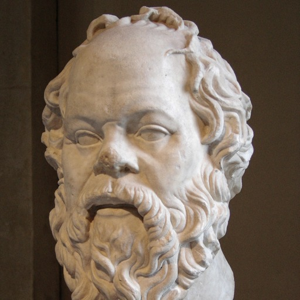

# Expert Roles

A public catalogue of expert roles for AI assistants, inspired by the ideas and
methods of recognized specialists. Browse by name or specialty and bring their
perspective to your tasks in Codex or Claude Code.

Each role is an independent AI interpretation of the expert's publicly
documented work.

<!-- BEGIN GENERATED SUMMARY -->

**68 experts · Codex and Claude Code role files**

<!-- END GENERATED SUMMARY -->

[Browse experts](src/roles/README.md#meet-the-experts) ·
[Browse by specialty](src/roles/README.md#browse-by-specialty) ·
[Use a role](#use-a-role) · [Contribute](#contribute)

## Role catalogue

A few starting points from the collection. Open a profile for suggested uses,
public references and role files.

<!-- BEGIN GENERATED FEATURED -->

<!-- Generated by src/generate.py; curate FEATURED_EXPERTS there. -->
<table>
<tr>
<td align="center" width="33%">
 
<a href="src/roles/steve-jobs/README.md"><strong>Steve Jobs</strong></a> 
Sharpen a product&#x27;s focus
</td>
<td align="center" width="33%">
 
<a href="src/roles/warren-buffett/README.md"><strong>Warren Buffett</strong></a> 
Examine an investment thesis
</td>
<td align="center" width="33%">
 
<a href="src/roles/jordan-peterson/README.md"><strong>Jordan Peterson</strong></a> 
Explore personality and motivation
</td>
</tr>
<tr>
<td align="center" width="33%">
 
<a href="src/roles/don-norman/README.md"><strong>Don Norman</strong></a> 
Find what makes a design confusing
</td>
<td align="center" width="33%">
 
<a href="src/roles/eliyahu-goldratt/README.md"><strong>Eliyahu Goldratt</strong></a> 
Identify a process&#x27;s main constraint
</td>
<td align="center" width="33%">
 
<a href="src/roles/socrates/README.md"><strong>Socrates</strong></a> 
Question assumptions in an argument
</td>
</tr>
</table>

**[Browse all 68 experts by name or specialty →](src/roles/README.md)**

<!-- END GENERATED FEATURED -->

Portraits may be AI-generated. Each profile identifies its image type and links to its sources and terms.

## Use a role

1. Choose a [Codex](dist/codex/README.md) or
   [Claude Code](dist/claude/README.md) role and follow the
   [setup guide](docs/delivery.md#use-a-native-role).
2. Describe your task, relevant evidence and constraints. Let the assistant
   select a suitable available role, or request an expert role by name.

For example, after setting up the role:

> Use the AI role inspired by Steve Jobs to review this product proposal.
> Where should it be simpler or more focused?

## Who is included?

Real people recognized for substantial contributions or demonstrated mastery in
an area, with publicly documented ideas, methods or practice useful for relevant
tasks. See the [selection criteria](CONTRIBUTING.md#expert-selection).

## Contribute

[Suggest an expert or improvement](https://github.com/shpoont/expert-roles/issues),
or follow the [contribution guide](CONTRIBUTING.md) to submit a change.

## Versions and releases

[Released versions](https://github.com/shpoont/expert-roles/releases) and the
[changelog](CHANGELOG.md) track the library. Catalogues follow current sources;
versioned role files are updated during
[release preparation](docs/delivery.md#versions-and-releases).

## Project documentation

[Project scope](PROJECT.md) · [Design and current work](docs/README.md) ·
[Sources and generation](src/README.md) · [Checks](tests/README.md)

Maintained by Leon.id Komarovsky.

## Requests from featured experts

Featured experts and their representatives can request corrections or removal at
[leonid@komarovsky.info](mailto:leonid@komarovsky.info).
See the [request policy](docs/requests.md) for response times and scope.

## License

Original project content and code, including role files, the SVG template
and name placeholders, use [MIT](LICENSE). Keep its copyright and permission
notice with copies or substantial portions.

Photographs and generated adaptations of licensed references retain their
individually recorded terms. Follow the image licenses and
credits recorded on each expert's profile; see the
[photo policy](CONTRIBUTING.md#photo-sources-and-licenses).

ESCO vocabulary material retains CC BY 4.0 terms; Wikidata material uses CC0.
Preserve the [source credits](docs/elements/specialties.md#source-attribution)
when redistributing vocabulary material.

## Disclaimer

This collection is provided "as is", without warranties of any kind. To the
maximum extent permitted by law, the owner and contributors are not liable
for any loss, damage or other consequences arising from its use. Review
role instructions and assess AI-generated output before relying on it.

This is an independent project and is not affiliated with, endorsed by or
sponsored by the featured experts, their estates or organizations, OpenAI
or Anthropic. Role outputs are AI-generated interpretations of publicly
documented work, not statements by the experts themselves.
