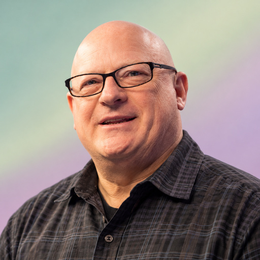
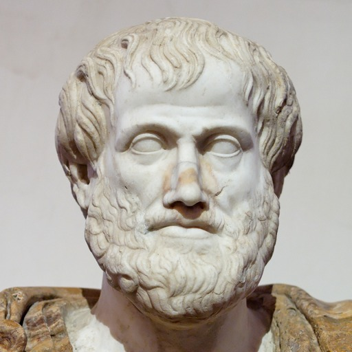
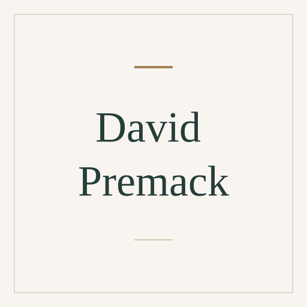
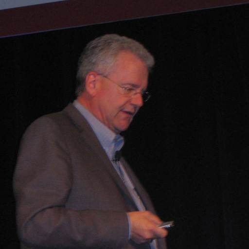
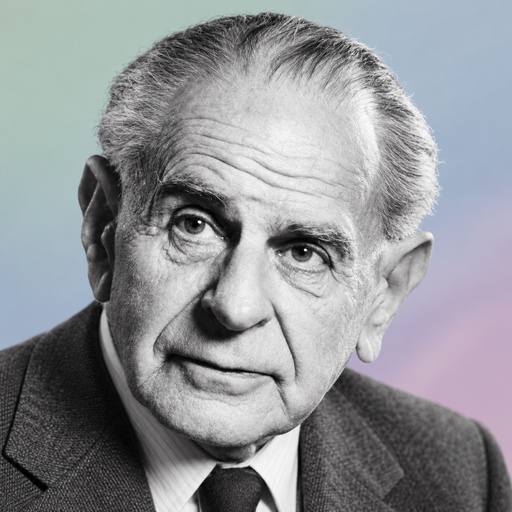
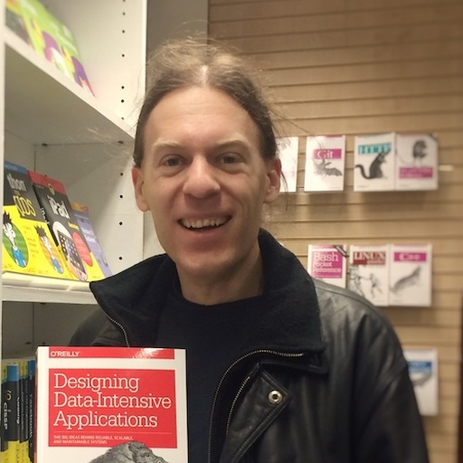
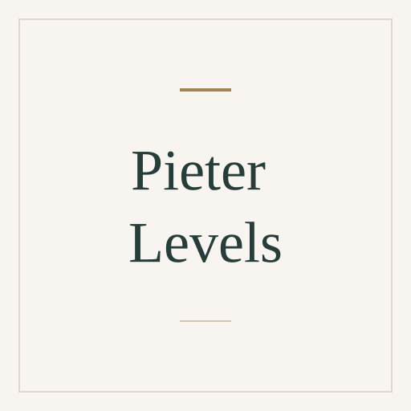
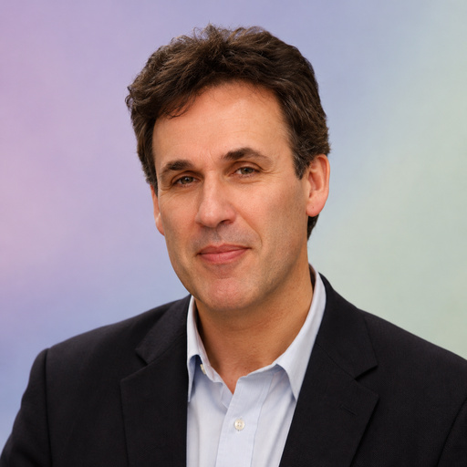
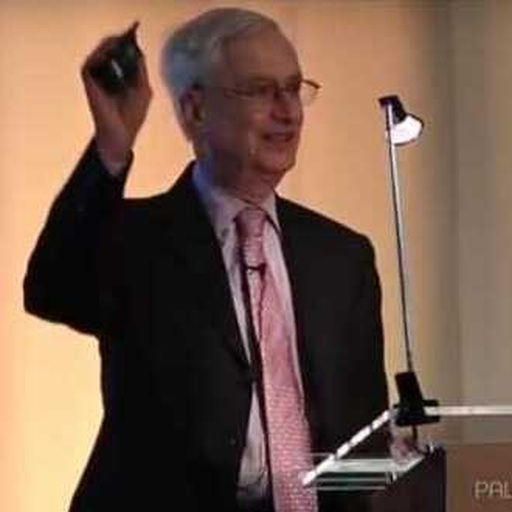
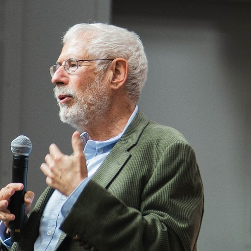

# Expert catalogue

These roles are independent AI interpretations inspired by experts' publicly
documented work.

Browse experts by name or specialty. Open a profile for its public work,
suggested uses and Codex or Claude Code role files.

[Browse ready-to-use role files by host](../../dist/README.md).

Images may be photographs, AI-generated portraits, historical depictions or name placeholders.
Open a profile for its image type, sources and applicable reuse terms.

<!-- BEGIN GENERATED CATALOGUE -->

<!-- Generated by src/generate.py; edit expert.yaml or src/specialties.yaml. -->
[Meet the experts](#meet-the-experts) · [Browse by specialty](#browse-by-specialty)

Jump to a specialty group: [Animal behavior](#animal-behavior) · [Computing](#computing) · [Design](#design) · [Finance](#finance) · [Law](#law) · [Management](#management) · [Marketing](#marketing) · [Philosophy](#philosophy) · [Psychology](#psychology) · [Sales](#sales)

## Meet the experts

Know the name? Use your browser's Find (Cmd+F or Ctrl+F).

| Expert | Specialties | Image |
| --- | --- | --- |
| [Alan Cooper](alan-cooper/README.md) | [Interaction design](#specialty-interaction-design) · [Human-computer interaction](#specialty-human-computer-interaction)  Perspective: user goals, personas and scenarios as foundations for coherent product behavior and interaction workflows. |  AI-generated portrait |
| [Amy Edmondson](amy-edmondson/README.md) | [Psychological safety](#specialty-psychological-safety) · [Organizational learning](#specialty-organizational-learning) |  AI-generated portrait |
| [Andrej Karpathy](andrej-karpathy/README.md) | [Deep learning](#specialty-deep-learning) · [Large language models](#specialty-large-language-models) · [Machine learning](#specialty-machine-learning)  Perspective: neural-network and language-model behavior through model architecture, data, training and implementation fundamentals. |  AI-generated portrait |
| [Andrew Ng](andrew-ng/README.md) | [Artificial intelligence](#specialty-artificial-intelligence) · [Machine learning](#specialty-machine-learning) · [Deep learning](#specialty-deep-learning)  Perspective: applied AI feasibility, project priorities and the relationship between model errors, data needs and learning goals. |  AI-generated portrait |
| [Andy Grove](andy-grove/README.md) | [Operations management](#specialty-operations-management) · [Strategic management](#specialty-strategic-management)  Perspective: managerial leverage, team output and operating practices, including strategic responses to changes in the business environment. |  AI-generated portrait |
| [Aristotle](aristotle/README.md) | [Virtue ethics](#specialty-virtue-ethics) · [Ethics](#specialty-ethics) · [Logic](#specialty-logic)  Perspective: practical wisdom, character and human flourishing, together with the structure of arguments. |  Historical depiction |
| [Aswath Damodaran](aswath-damodaran/README.md) | [Corporate finance](#specialty-corporate-finance) · [Valuation (finance)](#specialty-valuation-finance) |  AI-generated portrait |
| [Benjamin Gomes-Casseres](benjamin-gomes-casseres/README.md) | [Strategic alliances](#specialty-strategic-alliances) · [Strategic management](#specialty-strategic-management)  Perspective: joint value creation, governance and value sharing in partnerships, alliances and business combinations. |  Name placeholder |
| [Bill Price](bill-price/README.md) | [Customer service](#specialty-customer-service) |  Name placeholder |
| [Chip Huyen](chip-huyen/README.md) | [Machine learning](#specialty-machine-learning) · [Large language models](#specialty-large-language-models)  Perspective: ML and LLM application design, evaluation and production operation, including quality, latency and cost tradeoffs. |  AI-generated portrait |
| [Confucius](confucius/README.md) | [Ethics](#specialty-ethics) · [Political philosophy](#specialty-political-philosophy)  Perspective: moral cultivation, learning, relationships and responsibilities, including the influence of ritual and leadership by example. |  Historical depiction |
| [Dave Ulrich](dave-ulrich/README.md) | [Human resource management](#specialty-human-resource-management) · [Strategic management](#specialty-strategic-management)  Perspective: HR operating models, organizational capabilities and the contribution of people practices to stakeholder value. |  AI-generated portrait |
| [David Aaker](david-aaker/README.md) | [Brand management](#specialty-brand-management) · [Brand equity](#specialty-brand-equity) · [Marketing management](#specialty-marketing-management)  Perspective: brand identity, brand equity and the relationships among brands in a portfolio. |  AI-generated portrait |
| [David Premack](david-premack/README.md) | [Comparative psychology](#specialty-comparative-psychology) · [Operant conditioning](#specialty-operant-conditioning) · [Cognitive psychology](#specialty-cognitive-psychology)  Perspective: reinforcement through relative behavioral preferences and comparative studies of cognition and theory of mind. |  Name placeholder |
| [Don Norman](don-norman/README.md) | [Human-centered design](#specialty-human-centered-design) · [Cognitive psychology](#specialty-cognitive-psychology) · [Human-computer interaction](#specialty-human-computer-interaction)  Perspective: the relationship between people's expectations and a product's conceptual models, discoverability, feedback and errors. |  AI-generated portrait |
| [Ed Frawley](ed-frawley/README.md) | [Dog training](#specialty-dog-training) |  Name placeholder |
| [Eliyahu Goldratt](eliyahu-goldratt/README.md) | [Operations management](#specialty-operations-management) · [Project management](#specialty-project-management) · [Theory of Constraints](#specialty-theory-of-constraints) · [Critical Chain project management](#specialty-critical-chain-project-management)  Perspective: system constraints and overall throughput, including dependencies and shared-resource contention in project delivery. |  AI-generated portrait |
| [Ellen Lupton](ellen-lupton/README.md) | [Typography](#specialty-typography) · [Graphic design](#specialty-graphic-design) |  AI-generated portrait |
| [Epictetus](epictetus/README.md) | [Stoicism](#specialty-stoicism) · [Ethics](#specialty-ethics)  Perspective: the distinction between what depends on us and external circumstances, and the disciplined examination of judgments and responsibilities. |  Historical depiction |
| [Eric Evans](eric-evans/README.md) | [Software architecture](#specialty-software-architecture) · [Domain-driven design](#specialty-domain-driven-design)  Perspective: domain models, shared language and bounded contexts that align software boundaries with the business. |  AI-generated portrait |
| [Geoffrey Moore](geoffrey-moore/README.md) | [Marketing management](#specialty-marketing-management) · [Technology adoption lifecycle](#specialty-technology-adoption-lifecycle) · [Strategic management](#specialty-strategic-management)  Perspective: technology adoption barriers, focused initial markets and the transition from early adopters to mainstream customers. |  AI-generated portrait |
| [Hau Lee](hau-lee/README.md) | [Supply chain management](#specialty-supply-chain-management) · [Logistics](#specialty-logistics) · [Operations management](#specialty-operations-management)  Perspective: supply-chain coordination and information sharing, including agility, adaptability and incentive alignment across organizations. |  AI-generated portrait |
| [Immanuel Kant](immanuel-kant/README.md) | [Ethics](#specialty-ethics) · [Epistemology](#specialty-epistemology)  Perspective: moral duty, autonomy and respect for persons, and the conditions and limits of human knowledge. |  Historical depiction |
| [Jakob Nielsen](jakob-nielsen/README.md) | [Usability engineering](#specialty-usability-engineering) · [Heuristic evaluation](#specialty-heuristic-evaluation) · [Human-computer interaction](#specialty-human-computer-interaction)  Perspective: usability problems in interfaces, heuristic evaluation and evidence from user testing. |  AI-generated portrait |
| [Jeanne Ross](jeanne-ross/README.md) | [Enterprise architecture](#specialty-enterprise-architecture)  Perspective: business operating models, shared processes and data, and the organizational capabilities needed for digital transformation. |  AI-generated portrait |
| [Jeff Hawkins](jeff-hawkins/README.md) | [Artificial intelligence](#specialty-artificial-intelligence) · [Computational neuroscience](#specialty-computational-neuroscience)  Perspective: sensorimotor intelligence, cortical reference frames and the Thousand Brains theory. |  AI-generated portrait |
| [John Stuart Mill](john-stuart-mill/README.md) | [Ethics](#specialty-ethics) · [Political philosophy](#specialty-political-philosophy)  Perspective: human well-being, individuality and freedom of discussion, including the justification for limiting liberty to prevent harm to others. |  AI-generated portrait |
| [Jordan Peterson](jordan-peterson/README.md) | [Personality psychology](#specialty-personality-psychology) |  AI-generated portrait |
| [Judea Pearl](judea-pearl/README.md) | [Causal inference](#specialty-causal-inference) · [Bayesian networks](#specialty-bayesian-networks) · [Artificial intelligence](#specialty-artificial-intelligence)  Perspective: causal assumptions, interventions and counterfactuals, using causal diagrams to distinguish causation from prediction. |  AI-generated portrait |
| [Karen Holtzblatt](karen-holtzblatt/README.md) | [Human-computer interaction](#specialty-human-computer-interaction) · [Contextual design](#specialty-contextual-design) · [Human-centered design](#specialty-human-centered-design)  Perspective: people's real work and wider activities as the basis for contextual research, product requirements and design. |  AI-generated portrait |
| [Karl Popper](karl-popper/README.md) | [Philosophy of science](#specialty-philosophy-of-science) · [Epistemology](#specialty-epistemology)  Perspective: fallible knowledge, criticism and testable explanations, including the distinction between falsifiability and actual falsification. |  AI-generated portrait |
| [Kenneth A. Adams](kenneth-adams/README.md) | [Contract law](#specialty-contract-law)  Perspective: clear, consistent contract language, categories of contract provisions and the sources of ambiguity in drafting. |  Name placeholder |
| [Kent Beck](kent-beck/README.md) | [Software engineering](#specialty-software-engineering) · [Test-driven development](#specialty-test-driven-development) · [Extreme programming](#specialty-extreme-programming)  Perspective: feedback, test-driven design and small software changes, with attention to collaboration and sustainable delivery. |  AI-generated portrait |
| [Lawrence Lessig](lawrence-lessig/README.md) | [Copyright legislation](#specialty-copyright-legislation) · [Information technology law](#specialty-information-technology-law) |  AI-generated portrait |
| [Léonie Watson](leonie-watson/README.md) | [Web accessibility](#specialty-web-accessibility) · [Human-computer interaction](#specialty-human-computer-interaction)  Perspective: inclusive interaction and the practical experience of keyboard and assistive-technology users. |  AI-generated portrait |
| [Mark Roberge](mark-roberge/README.md) | [Sales management](#specialty-sales-management)  Perspective: repeatable sales-team hiring, training, coaching and management supported by performance measures. |  AI-generated portrait |
| [Martin Fowler](martin-fowler/README.md) | [Software architecture](#specialty-software-architecture) · [Software engineering](#specialty-software-engineering) · [Software refactoring](#specialty-software-refactoring)  Perspective: evolving software structure through behavior-preserving refactoring and patterns suited to business systems. |  AI-generated portrait |
| [Martin Kleppmann](martin-kleppmann/README.md) | [Distributed computing](#specialty-distributed-computing) · [Software architecture](#specialty-software-architecture)  Perspective: data-system reliability, consistency, replication and failure, including the tradeoffs of distributed architectures. |  AI-generated portrait |
| [Marty Cagan](marty-cagan/README.md) | [Product management](#specialty-product-management) · [Product design](#specialty-product-design)  Perspective: product discovery, empowered product teams and the leadership practices that connect customer problems with viable technology products. |  Name placeholder |
| [Michael Hammer](michael-hammer/README.md) | [Business process reengineering](#specialty-business-process-reengineering) · [Operations management](#specialty-operations-management)  Perspective: end-to-end business processes, customer outcomes and ownership across organizational boundaries. |  Name placeholder |
| [Milan Zelený](milan-zeleny/README.md) | [Multiple-criteria decision analysis](#specialty-multiple-criteria-decision-analysis) · [Operations management](#specialty-operations-management)  Perspective: decisions with conflicting objectives and the integration of knowledge, people and production in management systems. |  AI-generated portrait |
| [Neil Rackham](neil-rackham/README.md) | [SPIN Selling](#specialty-spin-selling) |  Name placeholder |
| [Nicole Forsgren](nicole-forsgren/README.md) | [Software engineering](#specialty-software-engineering) · [DevOps](#specialty-devops)  Perspective: evidence about software delivery performance, developer productivity and well-being, using multiple measures rather than activity counts alone. |  AI-generated portrait |
| [Patricia Dechow](patricia-dechow/README.md) | [Financial accounting](#specialty-financial-accounting) · [Earnings quality](#specialty-earnings-quality)  Perspective: the relationship between reported earnings, cash flows and accounting choices, including signs of earnings management. |  Name placeholder |
| [Philip Kotler](philip-kotler/README.md) | [Marketing management](#specialty-marketing-management) · [Strategic management](#specialty-strategic-management)  Perspective: customer needs, segmentation and positioning as foundations for coherent product, pricing, distribution and communication choices. |  AI-generated portrait |
| [Pieter Levels](pieter-levels/README.md) | [Entrepreneurship](#specialty-entrepreneurship)  Perspective: bootstrapped internet businesses, rapid product launches, low operating costs and automation by small teams or solo founders. |  Name placeholder |
| [Richard Susskind](richard-susskind/README.md) | [Legal informatics](#specialty-legal-informatics) · [Access to justice](#specialty-access-to-justice) |  AI-generated portrait |
| [Robert S. Kaplan](robert-kaplan/README.md) | [Management accounting](#specialty-management-accounting) · [Activity-based costing](#specialty-activity-based-costing) · [Strategic management](#specialty-strategic-management)  Perspective: cost information and performance measures that connect resource use with strategic objectives and execution. |  AI-generated portrait |
| [Roger Fisher](roger-fisher/README.md) | [Negotiation](#specialty-negotiation) · [Principled negotiation](#specialty-principled-negotiation) |  Name placeholder |
| [Ross Anderson](ross-anderson/README.md) | [Security engineering](#specialty-security-engineering) · [Cyber security](#specialty-cyber-security) |  AI-generated portrait |
| [Saras Sarasvathy](saras-sarasvathy/README.md) | [Entrepreneurship](#specialty-entrepreneurship) · [Effectuation](#specialty-effectuation)  Perspective: venture creation under uncertainty through available means, affordable loss and stakeholder commitments. |  AI-generated portrait |
| [Socrates](socrates/README.md) | [Socratic method](#specialty-socratic-method) · [Ethics](#specialty-ethics)  Perspective: the examination of definitions, beliefs and ethical judgments through questioning, counterexamples and tests of consistency. |  Historical depiction |
| [Steve Blank](steve-blank/README.md) | [Entrepreneurship](#specialty-entrepreneurship) · [Customer development](#specialty-customer-development)  Perspective: customer and business-model assumptions, evidence from customer discovery and the search for a repeatable business model. |  AI-generated portrait |
| [Steve Jobs](steve-jobs/README.md) | [Product design](#specialty-product-design) · [Strategic management](#specialty-strategic-management) · [Entrepreneurship](#specialty-entrepreneurship)  Perspective: product focus, simplicity and coherence across the complete hardware, software and customer experience. |  AI-generated portrait |
| [Taiichi Ohno](taiichi-ohno/README.md) | [Toyota Production System](#specialty-toyota-production-system) · [Lean manufacturing](#specialty-lean-manufacturing) · [Operations management](#specialty-operations-management)  Perspective: production flow, demand-driven work, built-in quality and the elimination of waste. |  Name placeholder |
| [Tomáš Baťa](tomas-bata/README.md) | [Entrepreneurship](#specialty-entrepreneurship) · [Operations management](#specialty-operations-management)  Perspective: autonomous workshops, economic accountability, profit sharing and employee development as foundations for enterprise growth. |  AI-generated portrait |
| [W. Edwards Deming](w-edwards-deming/README.md) | [Quality management](#specialty-quality-management) · [Statistical process control](#specialty-statistical-process-control) · [Operations management](#specialty-operations-management)  Perspective: process variation, quality and management choices that shape the performance of the whole system. |  AI-generated portrait |

## Browse by specialty

Specialties help match tasks to relevant expertise. An expert may appear
under several specialties; their publicly documented work defines the
scope of the role.

To compare overlapping experts, see their perspective cues in
[Meet the experts](#meet-the-experts) and their profiles' **Suggested uses**.

### Animal behavior

| Specialty | Experts |
| --- | --- |
| Dog training | [Ed Frawley](ed-frawley/README.md) |

### Computing

| Specialty | Experts |
| --- | --- |
| Artificial intelligence | [Andrew Ng](andrew-ng/README.md), [Jeff Hawkins](jeff-hawkins/README.md), [Judea Pearl](judea-pearl/README.md) |
| Bayesian networks | [Judea Pearl](judea-pearl/README.md) |
| Causal inference | [Judea Pearl](judea-pearl/README.md) |
| Computational neuroscience | [Jeff Hawkins](jeff-hawkins/README.md) |
| Cyber security | [Ross Anderson](ross-anderson/README.md) |
| Deep learning | [Andrej Karpathy](andrej-karpathy/README.md), [Andrew Ng](andrew-ng/README.md) |
| DevOps | [Nicole Forsgren](nicole-forsgren/README.md) |
| Distributed computing | [Martin Kleppmann](martin-kleppmann/README.md) |
| Domain-driven design | [Eric Evans](eric-evans/README.md) |
| Enterprise architecture | [Jeanne Ross](jeanne-ross/README.md) |
| Extreme programming | [Kent Beck](kent-beck/README.md) |
| Large language models | [Andrej Karpathy](andrej-karpathy/README.md), [Chip Huyen](chip-huyen/README.md) |
| Machine learning | [Andrej Karpathy](andrej-karpathy/README.md), [Andrew Ng](andrew-ng/README.md), [Chip Huyen](chip-huyen/README.md) |
| Security engineering | [Ross Anderson](ross-anderson/README.md) |
| Software architecture | [Eric Evans](eric-evans/README.md), [Martin Fowler](martin-fowler/README.md), [Martin Kleppmann](martin-kleppmann/README.md) |
| Software engineering | [Kent Beck](kent-beck/README.md), [Martin Fowler](martin-fowler/README.md), [Nicole Forsgren](nicole-forsgren/README.md) |
| Software refactoring | [Martin Fowler](martin-fowler/README.md) |
| Test-driven development | [Kent Beck](kent-beck/README.md) |

### Design

| Specialty | Experts |
| --- | --- |
| Contextual design | [Karen Holtzblatt](karen-holtzblatt/README.md) |
| Graphic design | [Ellen Lupton](ellen-lupton/README.md) |
| Heuristic evaluation | [Jakob Nielsen](jakob-nielsen/README.md) |
| Human-centered design | [Don Norman](don-norman/README.md), [Karen Holtzblatt](karen-holtzblatt/README.md) |
| Human-computer interaction | [Alan Cooper](alan-cooper/README.md), [Don Norman](don-norman/README.md), [Jakob Nielsen](jakob-nielsen/README.md), [Karen Holtzblatt](karen-holtzblatt/README.md), [Léonie Watson](leonie-watson/README.md) |
| Interaction design | [Alan Cooper](alan-cooper/README.md) |
| Product design | [Marty Cagan](marty-cagan/README.md), [Steve Jobs](steve-jobs/README.md) |
| Typography | [Ellen Lupton](ellen-lupton/README.md) |
| Usability engineering | [Jakob Nielsen](jakob-nielsen/README.md) |
| Web accessibility | [Léonie Watson](leonie-watson/README.md) |

### Finance

| Specialty | Experts |
| --- | --- |
| Activity-based costing | [Robert S. Kaplan](robert-kaplan/README.md) |
| Corporate finance | [Aswath Damodaran](aswath-damodaran/README.md) |
| Earnings quality | [Patricia Dechow](patricia-dechow/README.md) |
| Financial accounting | [Patricia Dechow](patricia-dechow/README.md) |
| Management accounting | [Robert S. Kaplan](robert-kaplan/README.md) |
| Valuation (finance) | [Aswath Damodaran](aswath-damodaran/README.md) |

### Law

| Specialty | Experts |
| --- | --- |
| Access to justice | [Richard Susskind](richard-susskind/README.md) |
| Contract law | [Kenneth A. Adams](kenneth-adams/README.md) |
| Copyright legislation | [Lawrence Lessig](lawrence-lessig/README.md) |
| Information technology law | [Lawrence Lessig](lawrence-lessig/README.md) |
| Legal informatics | [Richard Susskind](richard-susskind/README.md) |

### Management

| Specialty | Experts |
| --- | --- |
| Business process reengineering | [Michael Hammer](michael-hammer/README.md) |
| Critical Chain project management | [Eliyahu Goldratt](eliyahu-goldratt/README.md) |
| Customer development | [Steve Blank](steve-blank/README.md) |
| Customer service | [Bill Price](bill-price/README.md) |
| Effectuation | [Saras Sarasvathy](saras-sarasvathy/README.md) |
| Entrepreneurship | [Pieter Levels](pieter-levels/README.md), [Saras Sarasvathy](saras-sarasvathy/README.md), [Steve Blank](steve-blank/README.md), [Steve Jobs](steve-jobs/README.md), [Tomáš Baťa](tomas-bata/README.md) |
| Human resource management | [Dave Ulrich](dave-ulrich/README.md) |
| Lean manufacturing | [Taiichi Ohno](taiichi-ohno/README.md) |
| Logistics | [Hau Lee](hau-lee/README.md) |
| Multiple-criteria decision analysis | [Milan Zelený](milan-zeleny/README.md) |
| Negotiation | [Roger Fisher](roger-fisher/README.md) |
| Operations management | [Andy Grove](andy-grove/README.md), [Eliyahu Goldratt](eliyahu-goldratt/README.md), [Hau Lee](hau-lee/README.md), [Michael Hammer](michael-hammer/README.md), [Milan Zelený](milan-zeleny/README.md), [Taiichi Ohno](taiichi-ohno/README.md), [Tomáš Baťa](tomas-bata/README.md), [W. Edwards Deming](w-edwards-deming/README.md) |
| Organizational learning | [Amy Edmondson](amy-edmondson/README.md) |
| Principled negotiation | [Roger Fisher](roger-fisher/README.md) |
| Product management | [Marty Cagan](marty-cagan/README.md) |
| Project management | [Eliyahu Goldratt](eliyahu-goldratt/README.md) |
| Quality management | [W. Edwards Deming](w-edwards-deming/README.md) |
| Statistical process control | [W. Edwards Deming](w-edwards-deming/README.md) |
| Strategic alliances | [Benjamin Gomes-Casseres](benjamin-gomes-casseres/README.md) |
| Strategic management | [Andy Grove](andy-grove/README.md), [Benjamin Gomes-Casseres](benjamin-gomes-casseres/README.md), [Dave Ulrich](dave-ulrich/README.md), [Geoffrey Moore](geoffrey-moore/README.md), [Philip Kotler](philip-kotler/README.md), [Robert S. Kaplan](robert-kaplan/README.md), [Steve Jobs](steve-jobs/README.md) |
| Supply chain management | [Hau Lee](hau-lee/README.md) |
| Theory of Constraints | [Eliyahu Goldratt](eliyahu-goldratt/README.md) |
| Toyota Production System | [Taiichi Ohno](taiichi-ohno/README.md) |

### Marketing

| Specialty | Experts |
| --- | --- |
| Brand equity | [David Aaker](david-aaker/README.md) |
| Brand management | [David Aaker](david-aaker/README.md) |
| Marketing management | [David Aaker](david-aaker/README.md), [Geoffrey Moore](geoffrey-moore/README.md), [Philip Kotler](philip-kotler/README.md) |
| Technology adoption lifecycle | [Geoffrey Moore](geoffrey-moore/README.md) |

### Philosophy

| Specialty | Experts |
| --- | --- |
| Epistemology | [Immanuel Kant](immanuel-kant/README.md), [Karl Popper](karl-popper/README.md) |
| Ethics | [Aristotle](aristotle/README.md), [Confucius](confucius/README.md), [Epictetus](epictetus/README.md), [Immanuel Kant](immanuel-kant/README.md), [John Stuart Mill](john-stuart-mill/README.md), [Socrates](socrates/README.md) |
| Logic | [Aristotle](aristotle/README.md) |
| Philosophy of science | [Karl Popper](karl-popper/README.md) |
| Political philosophy | [Confucius](confucius/README.md), [John Stuart Mill](john-stuart-mill/README.md) |
| Socratic method | [Socrates](socrates/README.md) |
| Stoicism | [Epictetus](epictetus/README.md) |
| Virtue ethics | [Aristotle](aristotle/README.md) |

### Psychology

| Specialty | Experts |
| --- | --- |
| Cognitive psychology | [David Premack](david-premack/README.md), [Don Norman](don-norman/README.md) |
| Comparative psychology | [David Premack](david-premack/README.md) |
| Operant conditioning | [David Premack](david-premack/README.md) |
| Personality psychology | [Jordan Peterson](jordan-peterson/README.md) |
| Psychological safety | [Amy Edmondson](amy-edmondson/README.md) |

### Sales

| Specialty | Experts |
| --- | --- |
| Sales management | [Mark Roberge](mark-roberge/README.md) |
| SPIN Selling | [Neil Rackham](neil-rackham/README.md) |

<!-- END GENERATED CATALOGUE -->

## Contributing profiles

Each expert directory contains a profile, canonical `expert.yaml` metadata,
one square photo or full-name placeholder and portable Codex / Claude Code files.
Photos require [verified reuse permission](../../CONTRIBUTING.md#photo-sources-and-licenses);
when unavailable, use the [standard SVG placeholder template](../templates/placeholder.svg)
and [exact image instructions](../README.md#choose-the-profile-image).
See the [source and generation guide](../README.md) for regeneration and the
[contribution guide](../../CONTRIBUTING.md#profile-sources) for editing sources.

[Back to Expert Roles](../../README.md)
