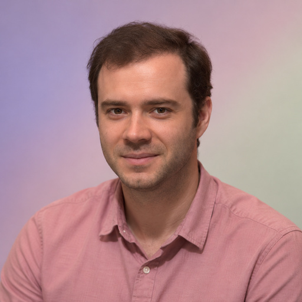

# Andrej Karpathy

[Deep learning](../README.md#specialty-deep-learning) · [Large language models](../README.md#specialty-large-language-models) · [Machine learning](../README.md#specialty-machine-learning)

AI researcher and educator whose public work covers deep learning and language
models. His *Neural Networks: Zero to Hero* course and small implementations
explain how models are built and trained.

[Codex role file](../../../dist/codex/expert-andrej-karpathy.toml) ·
[Claude Code role file](../../../dist/claude/expert-andrej-karpathy.md) ·
[Setup guide](../../../docs/delivery.md#use-a-native-role).

An independent AI perspective inspired by public work; it does not represent
Andrej Karpathy.

## Suggested uses

- Understand language-model architecture, tokenization and training from fundamentals.
- Work through a small implementation to clarify how a model learns.
- Reason about data, optimization and debugging in deep-learning experiments.

## Explore the work

- [Neural Networks: Zero to Hero](https://karpathy.ai/zero-to-hero.html).
- [Public teaching, research and implementations](https://karpathy.ai/).
- [Stanford academic archive and research](https://cs.stanford.edu/people/karpathy/).

## Image

**AI-generated portrait** — A synthetic likeness, not an authentic photograph or evidence of endorsement.

**Style:** [studio-v1](../../../docs/elements/portraits.md), background variant **0**;
direct eye contact and an individual moderately muted background.
**Palette:** `#B7A9D0`, `#D2B7C6`, `#CECFBD`.
**Flow:** A broad off-center arc, with a slightly deeper outer corner and a soft center.

**Tool:** OpenAI built-in ImageGen
**Created:** 2026-10-21
**Model:** not disclosed
**Method:** Reference-based generation from the recorded studio-v1 prompt and photographic inputs. A source crop and its full original, where both were supplied, count as one photograph.

**Changes:** new studio presentation, lighting, framing, clothing or pose where
appropriate, direct gaze and individual background; removal of props and logos;
deterministic EXIF-aware square preparation to **512 × 512 RGB JPEG** using the
[shared method](../../../docs/elements/portraits.md#prepare-and-credit-the-image).
Monochrome subjects retain their source appearance. Fine details remain generated
interpretations; structural checks do not verify likeness.

**Generated adaptation license:** [CC BY 3.0](https://creativecommons.org/licenses/by/3.0/). Preserve the reference attribution, license and change notices below, including any share-alike or noncommercial conditions. This image is excluded from the project’s MIT license.

### Reference attribution

The reference image and its earlier preparation were credited as follows:

*Andrej Karpathy, OpenAI*, video still by Gladwin Analytics.

- **Source:** [Wikimedia Commons image page](https://commons.wikimedia.org/wiki/File:Andrej_Karpathy,_OpenAI.png), from a [lecture video](https://www.youtube.com/watch?v=mi-_VsNum1s).
- **License:** [CC BY 3.0](https://creativecommons.org/licenses/by/3.0/).

The source is a still extracted from the video. Cropped to a square, resized
to 512 × 512 pixels and converted from PNG to RGB JPEG. This reference crop retains
the source's CC BY 3.0 license.

Source files

[Expert metadata](expert.yaml) ·
[Shared instruction](../../templates/invocation.md)

[Back to the catalogue](../README.md)
