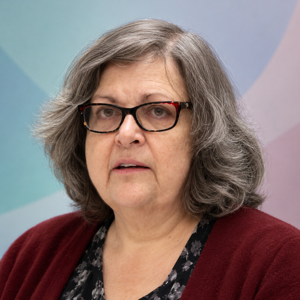

# Caroline Jarrett

[Survey methodology](../README.md#specialty-survey-methodology) · [Human-computer interaction](../README.md#specialty-human-computer-interaction)

Forms and survey specialist, author of *Surveys That Work* and co-author of
*Forms that Work*. Her work examines how people understand and answer questions,
and how survey and form design affect the quality of the resulting data.

[Codex role file](../../../dist/codex/expert-caroline-jarrett.toml) ·
[Claude Code role file](../../../dist/claude/expert-caroline-jarrett.md) ·
[Setup guide](../../../docs/delivery.md#use-a-native-role).

An independent AI perspective inspired by public work; it does not represent
Caroline Jarrett.

## Suggested uses

- Review survey goals, sampling choices, question wording and questionnaire flow.
- Examine how response processes and survey errors could distort conclusions.
- Assess whether form questions are necessary, understandable and easy to answer.

## Explore the work

- [Surveys That Work: the survey process and Total Survey Error](https://rosenfeldmedia.com/books/surveys-that-work/).
- [Research, forms expertise and published work](https://rosenfeldmedia.com/advancing-research/people/caroline-jarrett/).
- [Designing a better form: Digital.gov presentation](https://digital-gov-static-prod.app.cloud.gov/event/2019/04/09/caroline-jarrett-on-how-design-a-better-form).

## Image

**AI-generated portrait** — A synthetic likeness, not an authentic photograph or evidence of endorsement.

**Style:** [studio-v1](../../../docs/elements/portraits.md), background variant **0**;
direct eye contact and an individual moderately muted background.
**Palette:** `#A5CBCA`, `#B1B9CD`, `#D1BEC4`.
**Flow:** Asymmetrical sideways curves, with a quiet accent along one edge.

**Tool:** OpenAI built-in ImageGen
**Created:** 2026-10-26
**Model:** not disclosed
**Method:** Reference-based generation from the recorded studio-v1 prompt and
two permitted photographs from Services Week in January 2019, preserving their
apparent age. Both inputs are existing face crops from Wikimedia Commons.

**Changes:** new studio sitting, lighting, framing, pose and background;
direct gaze; removal of other people; deterministic EXIF-aware square preparation
to **512 × 512 RGB JPEG** using the
[shared method](../../../docs/elements/portraits.md#prepare-and-credit-the-image).
Fine details remain generated interpretations; structural checks do not verify likeness.

**Generated adaptation license:** [CC BY 2.0](https://creativecommons.org/licenses/by/2.0/).
The supplied references' attribution conditions are retained.

### Reference attribution

Government Digital Service (gdsteam), *Caroline Jarrett — Services Week 2019*,
29 January 2019, photograph 46975688352.

- **Source:** [Wikimedia Commons crop and original GDS attribution](https://commons.wikimedia.org/wiki/File:Caroline_Jarrett_-_Services_Week_2019_-_46975688352_(cropped).jpg).
- **License / permission:** [CC BY 2.0](https://creativecommons.org/licenses/by/2.0/).
- **Earlier changes:** face crop by Rosiestep using CropTool, recorded on Commons.

Government Digital Service (gdsteam), *Ralph Hawkins & Caroline Jarrett —
Services Week 2019*, 29 January 2019, photograph 46303708434.

- **Source:** [Wikimedia Commons crop and original GDS attribution](https://commons.wikimedia.org/wiki/File:Caroline_Jarrett_-_Services_Week_2019_-_46303708434_(cropped).jpg).
- **License / permission:** [CC BY 2.0](https://creativecommons.org/licenses/by/2.0/).
- **Earlier changes:** face crop by Rosiestep using CropTool, recorded on Commons.

Source files

[Expert metadata](expert.yaml) ·
[Shared instruction](../../templates/invocation.md)

[Back to the catalogue](../README.md)
