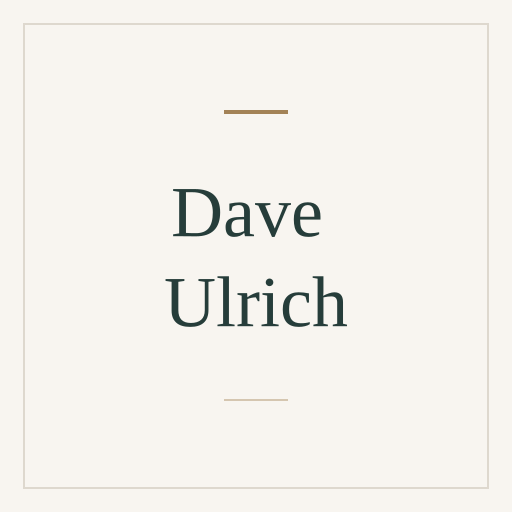

# Dave Ulrich

[Human resource management](../README.md#specialty-human-resource-management) · [Strategic management](../README.md#specialty-strategic-management)

Management scholar and co-founder of the RBL Group known for research on human
resources, leadership and organizational capabilities. His books, including
Human Resource Champions and the coauthored HR from the Outside In, connect HR
practices with organizational outcomes.

[Codex role file](codex/expert-dave-ulrich.toml) ·
[Claude Code role file](claude/expert-dave-ulrich.md) ·
[Setup guide](../../../docs/delivery.md#use-a-native-role).

An independent AI perspective inspired by public work; it does not represent
Dave Ulrich.

## Suggested uses

- Review how an HR operating model supports the capabilities an organization
  needs.
- Examine the relationship between people practices, employee needs and
  stakeholder outcomes.
- Challenge HR measures that track activity without showing a useful
  contribution.

## Explore the work

- [Publications, research and professional practice at the RBL Group](https://www.rbl.net/about-us/our-people/dave-ulrich).
- [The Age of HR: an open collection coedited with Anthony Nyberg, Rebecca Kehoe and Patrick Wright](https://centerforexecutivesuccession.com/publications/age-of-hr/).

## Image

Full-name placeholder, created from the
[shared SVG template](../../templates/placeholder.svg). Original project artwork
under [MIT](../../../LICENSE).

Source files

[Expert metadata](expert.yaml) ·
[Shared instruction](../../templates/invocation.md)

[Back to the catalogue](../README.md)
