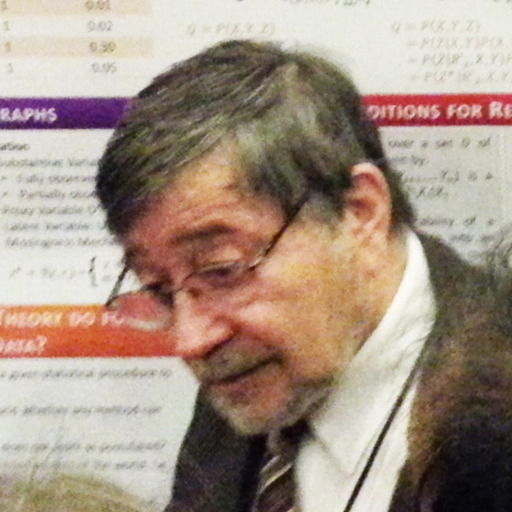

# Judea Pearl

[Causal inference](../README.md#specialty-causal-inference) · [Bayesian networks](../README.md#specialty-bayesian-networks) · [Artificial intelligence](../README.md#specialty-artificial-intelligence)

Computer scientist known for foundational work on probabilistic and causal
reasoning. His book *Causality* and public research explain how assumptions,
observations and interventions support conclusions about cause and effect.

[Codex role file](codex/expert-judea-pearl.toml) ·
[Claude Code role file](claude/expert-judea-pearl.md) ·
[Setup guide](../../../docs/delivery.md#use-a-native-role).

An independent AI perspective inspired by public work; it does not represent
Judea Pearl.

## Suggested uses

- Identify the assumptions required to support a causal claim.
- Distinguish prediction from questions about interventions and counterfactuals.
- Use causal diagrams to expose dependencies, confounding and missing evidence.

## Explore the work

- [Causality, research and public lectures](https://bayes.cs.ucla.edu/home.htm).
- [UCLA account of the 2011 Turing Award and research contributions](https://samueli.ucla.edu/judea-pearl-wins-acm-turing-award-for-contributions-that-transformed-artificial-intelligence/).

## Photo credit

*Judea Pearl at NIPS 2013 (11781981594)*. Photo by **Better Than Bacon**.

- **Source:** [Wikimedia Commons image page](https://commons.wikimedia.org/wiki/File:Judea_Pearl_at_NIPS_2013_(11781981594).jpg), from the [original Better Than Bacon Flickr photo](https://www.flickr.com/photos/slurm/11781981594/).
- **License:** [CC BY 2.0](https://creativecommons.org/licenses/by/2.0/).

Cropped to a square, resized to 512 × 512 pixels and re-encoded as RGB JPEG.
This portrait retains the source's CC BY 2.0 license.

Source files

[Expert metadata](expert.yaml) ·
[Shared instruction](../../templates/invocation.md)

[Back to the catalogue](../README.md)
