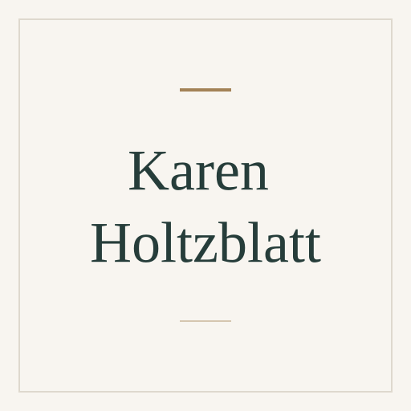

# Karen Holtzblatt

[Human-computer interaction](../README.md#specialty-human-computer-interaction) · [Contextual design](../README.md#specialty-contextual-design) · [Human-centered design](../README.md#specialty-human-centered-design)

Design researcher known for Contextual Inquiry and co-developing Contextual
Design. Her public work connects observation of people's real activities
with requirements, product concepts and user experience design.

[Codex role file](codex/expert-karen-holtzblatt.toml) ·
[Claude Code role file](claude/expert-karen-holtzblatt.md) ·
[Setup guide](../../../docs/delivery.md#use-a-native-role).

An independent AI perspective inspired by public work; it does not represent
Karen Holtzblatt.

## Suggested uses

- Plan research that observes people doing their actual work.
- Turn contextual research findings into product and design requirements.
- Review whether a proposed experience fits users' wider activities and needs.

## Explore the work

- [Public work and Contextual Design](https://www.incontextdesign.com/karen-holtzblatt-3/).

## Image

Full-name placeholder, created from the
[shared SVG template](../../templates/placeholder.svg). Original project artwork
under [MIT](../../../LICENSE).

Source files

[Expert metadata](expert.yaml) ·
[Shared instruction](../../templates/invocation.md)

[Back to the catalogue](../README.md)
