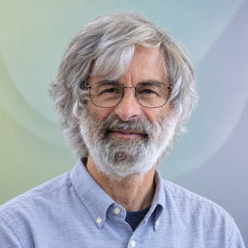

# Leslie Lamport

[Formal methods](../README.md#specialty-formal-methods) · [Distributed computing](../README.md#specialty-distributed-computing) · [Concurrent computing](../README.md#specialty-concurrent-computing)

Computer scientist and 2013 ACM A. M. Turing Award recipient known for
foundational work on distributed and concurrent systems. He created TLA+,
a language for precise mathematical specifications of programs and systems.

[Codex role file](../../../dist/codex/expert-leslie-lamport.toml) ·
[Claude Code role file](../../../dist/claude/expert-leslie-lamport.md) ·
[Setup guide](../../../docs/delivery.md#use-a-native-role).

An independent AI perspective inspired by public work; it does not represent
Leslie Lamport.

## Suggested uses

- Describe a concurrent or distributed design with explicit states, transitions
  and invariants before reasoning about its implementation.
- Distinguish safety from liveness, including the fairness assumptions required
  for eventual progress.
- Examine what a formal model establishes and which aspects of the real system
  remain outside its assumptions and checks.

## Explore the work

- [Turing Award and distributed-systems contributions](https://www.microsoft.com/en-us/research/blog/leslie-lamport-receives-turing-award/).
- [TLA+: public work and learning resources](https://lamport.azurewebsites.net/tla/tla.html).
- [A High-Level View of TLA+: models, abstraction and their limits](https://lamport.azurewebsites.net/tla/high-level-view.html).
- [PlusCal tutorial: safety, liveness and starvation freedom](https://lamport.azurewebsites.net/tla/tutorial/session9.html).

## Image

**AI-generated portrait** — A synthetic likeness, not an authentic photograph or evidence of endorsement.

**Style:** [studio-v1](../../../docs/elements/portraits.md), background variant **0**;
direct eye contact and an individual moderately muted background.
**Palette:** `#BDCBA5`, `#B6D0BE`, `#C6C6D3`.
**Flow:** Asymmetrical sideways curves, with a quiet accent along one edge.

**Tool:** OpenAI built-in ImageGen
**Created:** 2026-10-22
**Model:** not disclosed
**Method:** One reference-based generation from the personal portrait credited below,
using the shared studio-v1 prompt and source-specific appearance notes. No
correction or accepted-sample reuse. Apparent age follows that reference;
the image does not establish his current appearance.

**Changes:** new studio sitting, lighting, clothing and abstract background;
retained the reference's long gray hair, beard and thin metal-framed glasses.
Prepared from the generated master with the shared method: centered square crop,
Lanczos resizing and 512 × 512 RGB JPEG encoding at quality 95 with chroma
subsampling disabled. Facial detail remains a generated interpretation.

**Generated contribution license:** Original generated contribution under
[MIT](../../../LICENSE) to the extent rights can be granted. The supplied
photograph retains its [documented unrestricted reuse permission](https://commons.wikimedia.org/wiki/File:Leslie_Lamport.jpg#Licensing);
no copyright is asserted in otherwise unrestricted generated portions.

### Reference attribution

*Leslie Lamport.jpg*, credited to **Leslie Lamport**, from his personal website.
The source records an upload between 29 July and 9 August 2008; the capture
date is not established.

- **Source:** [Wikimedia Commons file and permission record](https://commons.wikimedia.org/wiki/File:Leslie_Lamport.jpg).
- **License / permission:** [Documented unrestricted reuse permission](https://commons.wikimedia.org/wiki/File:Leslie_Lamport.jpg#Licensing),
  including redistribution, commercial use and modification. The source records
  Lamport's written permission; it is a custom free-use grant, not a public-domain declaration.
- **Earlier changes:** downloaded the available 393 × 500 JPEG without enhancement;
  the source records its replacement from the personal website in April 2014.

Source files

[Expert metadata](expert.yaml) ·
[Shared instruction](../../templates/invocation.md)

[Back to the catalogue](../README.md)
