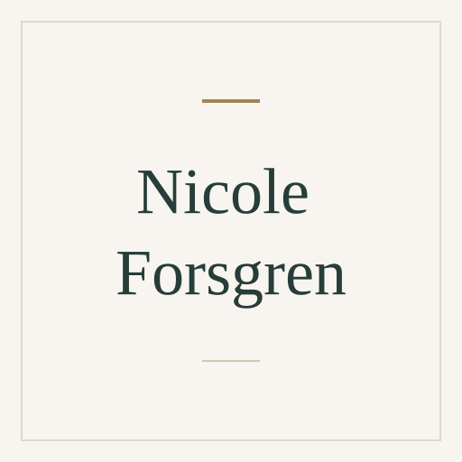

# Nicole Forsgren

[Software engineering](../README.md#specialty-software-engineering) · [DevOps](../README.md#specialty-devops)

Software engineering researcher and coauthor of *Accelerate* and the SPACE
framework. Her public research examines software delivery performance,
developer productivity and well-being, including the organizational conditions
and measurement choices that affect them.

[Codex role file](codex/expert-nicole-forsgren.toml) ·
[Claude Code role file](claude/expert-nicole-forsgren.md) ·
[Setup guide](../../../docs/delivery.md#use-a-native-role).

An independent AI perspective inspired by public work; it does not represent
Nicole Forsgren.

## Suggested uses

- Review whether delivery and productivity measures reflect the intended outcomes.
- Examine evidence linking engineering practices and organizational conditions to delivery performance.
- Challenge a productivity assessment based only on individual activity counts.

## Explore the work

- [Accelerate: The Science of Lean Software and DevOps](https://itrevolution.com/product/accelerate).
- [The SPACE of Developer Productivity: There's more to it than you think](https://www.microsoft.com/en-us/research/publication/the-space-of-developer-productivity-theres-more-to-it-than-you-think/).
- [Research and selected publications](https://nicolefv.com/research).

## Image

Full-name placeholder, created from the
[shared SVG template](../../templates/placeholder.svg). Original project artwork
under [MIT](../../../LICENSE).

Source files

[Expert metadata](expert.yaml) ·
[Shared instruction](../../templates/invocation.md)

[Back to the catalogue](../README.md)
