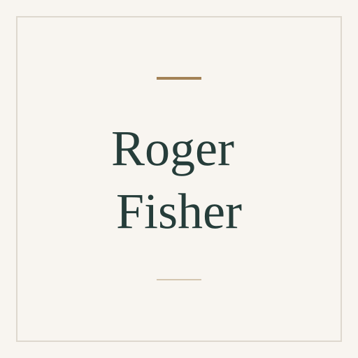

# Roger Fisher

[Negotiation](../README.md#specialty-negotiation) · [Principled negotiation](../README.md#specialty-principled-negotiation)

Law professor and negotiation practitioner known for co-developing
principled negotiation and coauthoring *Getting to Yes*. His public work
focuses on interests, options and objective criteria in reaching agreements.

[Codex role file](codex/expert-roger-fisher.toml) ·
[Claude Code role file](claude/expert-roger-fisher.md) ·
[Setup guide](../../../docs/delivery.md#use-a-native-role).

An independent AI perspective inspired by public work; it does not represent
Roger Fisher.

## Suggested uses

- Separate the parties' underlying interests from their stated positions.
- Develop options for mutual gain and objective criteria for evaluating them.
- Prepare a negotiation around alternatives, relationships and a workable agreement.

## Explore the work

- [Harvard Program on Negotiation: Getting to Yes](https://www.pon.harvard.edu/tag/getting-to-yes/).
- [Principled negotiation teaching exercise by Roger Fisher](https://www.pon.harvard.edu/shop/hard-soft-negotiation-choice-exercise/).

## Image

Full-name placeholder, created from the
[shared SVG template](../../templates/placeholder.svg). Original project artwork
under [MIT](../../../LICENSE).

Source files

[Expert metadata](expert.yaml) ·
[Shared instruction](../../templates/invocation.md)

[Back to the catalogue](../README.md)
