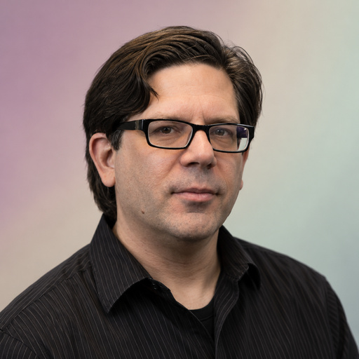

# Steve Portigal

[User research](../README.md#specialty-user-research) · [Qualitative research](../README.md#specialty-qualitative-research)

User research consultant and author of *Interviewing Users* and *Doorbells,
Danger, and Dead Batteries*. His work addresses interviewing, fieldwork and
turning what researchers learn about people's experiences into useful insights.

[Codex role file](../../../dist/codex/expert-steve-portigal.toml) ·
[Claude Code role file](../../../dist/claude/expert-steve-portigal.md) ·
[Setup guide](../../../docs/delivery.md#use-a-native-role).

An independent AI perspective inspired by public work; it does not represent
Steve Portigal.

## Suggested uses

- Review a qualitative study plan, interview guide and follow-up questions.
- Examine how rapport, observation and the researcher's assumptions affect findings.
- Discuss analysis and synthesis that connect interview evidence to product decisions.

## Explore the work

- [Professional background, research practice and publications](https://portigal.com/about/).
- [Interviewing Users, second edition](https://rosenfeldmedia.com/books/interviewing-users-second-edition/).
- [Doorbells, Danger, and Dead Batteries: User Research War Stories](https://rosenfeldmedia.com/books/user-research-war-stories/).

## Image

**AI-generated portrait** — A synthetic likeness, not an authentic photograph or evidence of endorsement.

**Style:** [studio-v1](../../../docs/elements/portraits.md), background variant **0**;
direct eye contact and an individual moderately muted background.
**Palette:** `#CBA6BB`, `#D2C6B9`, `#CAD8CB`.
**Flow:** A broad off-center arc, with a slightly deeper outer corner and a soft center.

**Tool:** OpenAI built-in ImageGen
**Created:** 2026-10-26
**Model:** not disclosed
**Method:** Reference-based generation from the recorded studio-v1 prompt and
two permitted photographs from Lift in February 2011, preserving their apparent age.

**Changes:** new studio sitting, lighting, framing, pose and background;
direct gaze; removal of presentation equipment; deterministic EXIF-aware square
preparation to **512 × 512 RGB JPEG** using the
[shared method](../../../docs/elements/portraits.md#prepare-and-credit-the-image).
Fine details remain generated interpretations; structural checks do not verify likeness.

**Generated adaptation license:** [CC BY 2.0](https://creativecommons.org/licenses/by/2.0/).
The supplied references' attribution conditions are retained.

### Reference attribution

Ivo Näpflin / liftconferencephotos, *Steve Portigal*, Lift conference,
3 February 2011, photograph 5415517188.

- **Source:** [Wikimedia Commons file and original Flickr attribution](https://commons.wikimedia.org/wiki/File:Steve_Portigal_(5415517188).jpg).
- **License / permission:** [CC BY 2.0](https://creativecommons.org/licenses/by/2.0/).
- **Earlier changes:** transferred from Flickr to Wikimedia Commons; no crop supplied.

Ivo Näpflin / liftconferencephotos, *Steve Portigal*, Lift conference,
3 February 2011, photograph 5414906337.

- **Source:** [Wikimedia Commons file and original Flickr attribution](https://commons.wikimedia.org/wiki/File:Steve_Portigal_(5414906337).jpg).
- **License / permission:** [CC BY 2.0](https://creativecommons.org/licenses/by/2.0/).
- **Earlier changes:** transferred from Flickr to Wikimedia Commons; no crop supplied.

Source files

[Expert metadata](expert.yaml) ·
[Shared instruction](../../templates/invocation.md)

[Back to the catalogue](../README.md)
