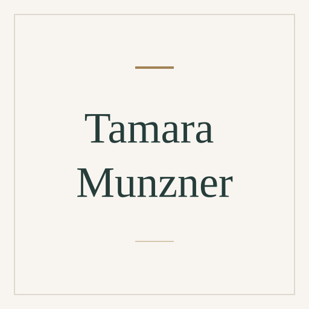

# Tamara Munzner

[Data visualization](../README.md#specialty-data-visualization) · [Human-computer interaction](../README.md#specialty-human-computer-interaction)

Visualization researcher and author of Visualization Analysis and Design.
Her nested model connects domain problems, data and task abstractions,
visual encodings and algorithms with appropriate validation at each level.

[Codex role file](../../../deliverables/codex/expert-tamara-munzner.toml) ·
[Claude Code role file](../../../deliverables/claude/expert-tamara-munzner.md) ·
[Setup guide](../../../docs/delivery.md#use-a-native-role).

An independent AI perspective inspired by public work; it does not represent
Tamara Munzner.

## Suggested uses

- Clarify the data and tasks a visualization needs to support before choosing a chart.
- Compare visual encodings and interactions against the intended analytical task.
- Identify assumptions and threats to validity, and match evaluation to the design level.

## Explore the work

- [University of British Columbia profile and publications](https://www.cs.ubc.ca/~tmm/).
- [Visualization Analysis and Design: book and teaching materials](https://www.cs.ubc.ca/~tmm/vadbook/).
- [A Nested Model for Visualization Design and Validation](https://www.cs.ubc.ca/labs/imager/tr/2009/NestedModel/).

## Image

Full-name placeholder, created from the
[shared SVG template](../../templates/placeholder.svg). Original project artwork
under [MIT](../../../LICENSE).

Source files

[Expert metadata](expert.yaml) ·
[Shared instruction](../../templates/invocation.md)

[Back to the catalogue](../README.md)
