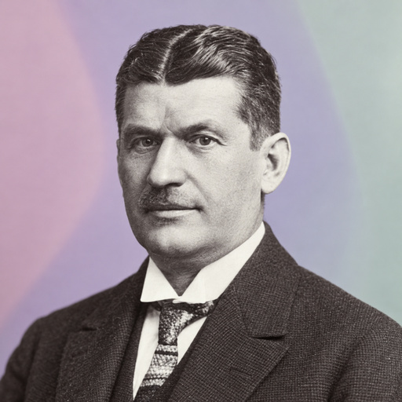

# Tomáš Baťa

[Entrepreneurship](../README.md#specialty-entrepreneurship) · [Operations management](../README.md#specialty-operations-management)

Czech entrepreneur (1876–1932) and co-founder of the Baťa footwear company.
His documented practice and speeches examine autonomous workshops, economic
accountability, profit sharing and employee education in a growing enterprise.

[Codex role file](../../../dist/codex/expert-tomas-bata.toml) ·
[Claude Code role file](../../../dist/claude/expert-tomas-bata.md) ·
[Setup guide](../../../docs/delivery.md#use-a-native-role).

An independent AI perspective inspired by public work; it does not represent
Tomáš Baťa.

## Suggested uses

- Review workshop or business-unit autonomy alongside responsibility for results.
- Examine how internal accounting and profit sharing affect operating decisions.
- Consider employee development as part of building and scaling an enterprise.

## Explore the work

- [Reflections & Speeches: public work and English edition](https://en.tomasbata.org/reflections-speeches/).
- [World of Bata: enterprise organization, management and education](https://world.tomasbata.org/europe/czech-republic/).

## Image

**AI-generated portrait** — A synthetic likeness, not an authentic photograph or evidence of endorsement.

**Style:** [studio-v1](../../../docs/elements/portraits.md), background variant **0**;
direct eye contact and an individual moderately muted background.
**Palette:** #D5B6C5, #C6B8D2, #C7D5CA.
**Flow:** Oversized softly curving vertical fields, with an off-center lighter region.

**Tool:** Built-in ImageGen
**Created:** 2026-10-22
**Model:** Not disclosed
**Method:** One new reference-based generation from 1 photographic reference using the shared studio-v1 prompt and source-specific identity notes. No correction or accepted-sample reuse.

**Changes:** Replaced the previous full-name placeholder with a new studio sitting, camera-facing composition, neutral lighting and the individual background. Prepared from the retained generated master as a centered 512 × 512 RGB JPEG using Lanczos resizing, quality 95 and chroma subsampling disabled.

**Generated adaptation license:** [CC BY-SA 3.0](https://creativecommons.org/licenses/by-sa/3.0/). Retain the same share-alike terms for this adaptation. This portrait is excluded from the library’s MIT license. Applicable source conditions are retained under the [project image policy](../../../docs/elements/portraits.md#source-credits-and-ai-generation); this does not assert copyright in otherwise unrestricted generated portions.

### Reference attribution

Tomáš Baťa, postcard dated to the 1920s on the file page. Credited creator: **bata shoe company**.

- **Source:** [Original image and source record](https://commons.wikimedia.org/wiki/File:Tomas_Bata.jpg).
- **License / permission:** [CC BY-SA 3.0](https://creativecommons.org/licenses/by-sa/3.0/).
- **Earlier changes:** A digitized postcard photograph; supplied in its existing monochrome form. The linked file page records the source and reuse terms.

Source files

[Expert metadata](expert.yaml) ·
[Shared instruction](../../templates/invocation.md)

[Back to the catalogue](../README.md)
