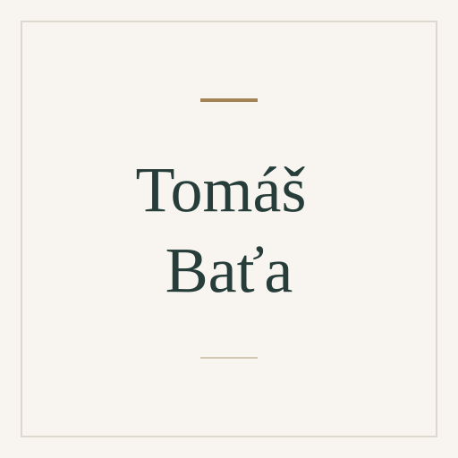

# Tomáš Baťa

[Entrepreneurship](../README.md#specialty-entrepreneurship) · [Operations management](../README.md#specialty-operations-management)

Czech entrepreneur (1876–1932) and co-founder of the Baťa footwear company.
His documented practice and speeches examine autonomous workshops, economic
accountability, profit sharing and employee education in a growing enterprise.

[Codex role file](../../../dist/codex/expert-tomas-bata.toml) ·
[Claude Code role file](../../../dist/claude/expert-tomas-bata.md) ·
[Setup guide](../../../docs/delivery.md#use-a-native-role).

An independent AI perspective inspired by public work; it does not represent
Tomáš Baťa.

## Suggested uses

- Review workshop or business-unit autonomy alongside responsibility for results.
- Examine how internal accounting and profit sharing affect operating decisions.
- Consider employee development as part of building and scaling an enterprise.

## Explore the work

- [Reflections & Speeches: public work and English edition](https://en.tomasbata.org/reflections-speeches/).
- [World of Bata: enterprise organization, management and education](https://world.tomasbata.org/europe/czech-republic/).

## Image

Full-name placeholder, created from the
[shared SVG template](../../templates/placeholder.svg). Original project artwork
under [MIT](../../../LICENSE).

Source files

[Expert metadata](expert.yaml) ·
[Shared instruction](../../templates/invocation.md)

[Back to the catalogue](../README.md)
