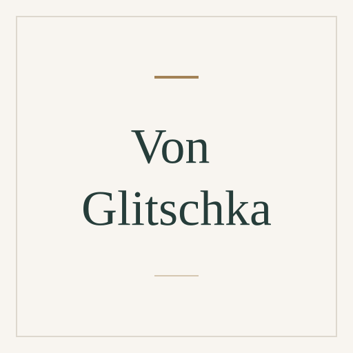

# Von Glitschka

[Graphic design](../README.md#specialty-graphic-design) · [Digital illustration](../README.md#specialty-digital-illustration) · [Vector graphics](../README.md#specialty-vector-graphics)

Illustrative designer, educator and author of *Vector Basic Training*. His
books and courses connect drawing and shape analysis with precise vector
construction, color and consistent detailing.

[Codex role file](../../../deliverables/codex/expert-von-glitschka.toml) ·
[Claude Code role file](../../../deliverables/claude/expert-von-glitschka.md) ·
[Setup guide](../../../docs/delivery.md#use-a-native-role).

An independent AI perspective inspired by public work; it does not represent
Von Glitschka.

## Suggested uses

- Turn a drawn concept into a clear construction plan with deliberate curves,
  anchor points and reusable shapes.
- Review color, shadows, highlights and small details in a vector illustration.
- Examine an icon family's visual continuity and the repeatability of its
  drawing and vector-building process.

## Explore the work

- [Vector Basic Training: systematic construction, curves, color and detail](https://www.peachpit.com/store/vector-basic-training-vector-basic-training-a-systematic-9780134165059).
- [Drawing Vector Graphics courses: illustration, workflow and iconography](https://www.glitschkastudios.com/dvg).
- [Publisher biography and professional practice](https://www.peachpit.com/authors/bio/4390850E-9E03-4F48-8B4F-DD779A08793B).

## Image

Full-name placeholder, created from the
[shared SVG template](../../templates/placeholder.svg). Original project artwork
under [MIT](../../../LICENSE).

Source files

[Expert metadata](expert.yaml) ·
[Shared instruction](../../templates/invocation.md)

[Back to the catalogue](../README.md)
