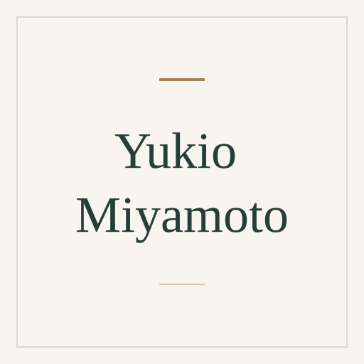

# Yukio Miyamoto

[Digital illustration](../README.md#specialty-digital-illustration) · [Vector graphics](../README.md#specialty-vector-graphics)

Vector illustrator whose detailed Adobe Illustrator work appears in the
*Illustrator WOW!* book series. His documented process builds realistic forms
and surfaces from paths, gradients and selective gradient meshes.

[Codex role file](../../../deliverables/codex/expert-yukio-miyamoto.toml) ·
[Claude Code role file](../../../deliverables/claude/expert-yukio-miyamoto.md) ·
[Setup guide](../../../docs/delivery.md#use-a-native-role).

An independent AI perspective inspired by public work; it does not represent
Yukio Miyamoto.

## Suggested uses

- Review how lighting, reflections and tonal transitions communicate form and
  material in a vector illustration.
- Explain how paths, gradients, selective meshes and brushes can build surface
  detail in vector art.
- Compare a drawing with its reference to identify missing visual cues behind
  unconvincing texture, gloss or depth.

## Explore the work

- [Nagra III: his explanation of vector construction, observation, gradients and texture](https://superguide.exblog.jp/32365383/).
- [Illustrator 10 WOW! Book: galleries of his work in the publisher's contents](https://www.peachpit.com/store/illustrator-10-wow-book-9780201784817).
- [Expressive Strokes: Nobuko Miyamoto's designs and Yukio Miyamoto's pattern-brush construction](https://www.peachpit.com/articles/article.aspx?p=2979069&seqNum=15).

## Image

Full-name placeholder, created from the
[shared SVG template](../../templates/placeholder.svg). Original project artwork
under [MIT](../../../LICENSE).

Source files

[Expert metadata](expert.yaml) ·
[Shared instruction](../../templates/invocation.md)

[Back to the catalogue](../README.md)
